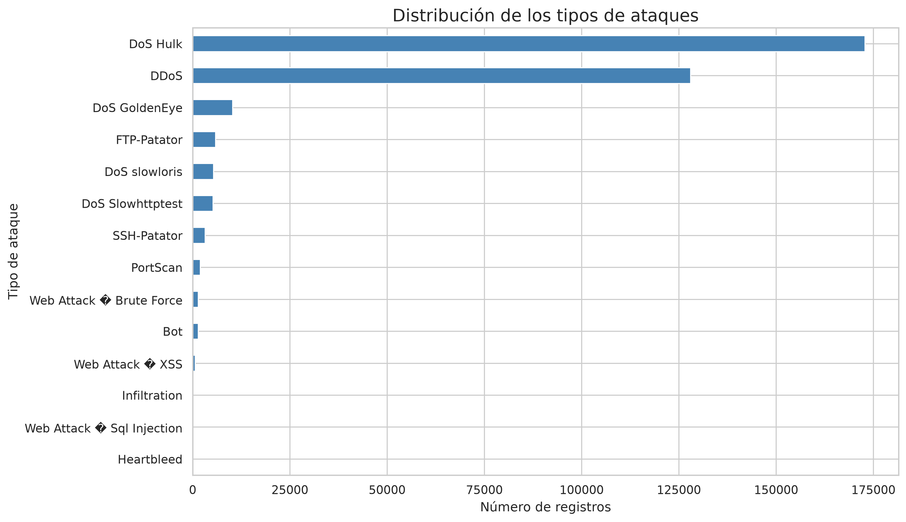
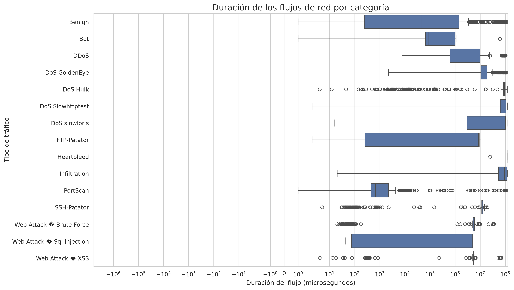

---
# ============================================================
# CONFIGURACIÓN INICIAL DEL DOCUMENTO
# ============================================================

# Título principal que aparecerá en la página.
title: "Análisis de tráfico de red CICIDS2017"

# Subtítulo que describe el objetivo del proyecto.
subtitle: "Exploración y análisis de datos aplicado a la ciberseguridad"

# Autor que aparecerá en la cabecera del documento.
author: "Proyecto académico"

# Utilizamos la fecha actual al generar el documento.
date: today

# Establecemos el idioma del documento en español.
lang: es
---

<!-- ============================================================
     1. INTRODUCCIÓN
     ============================================================ -->

<!-- Presentamos el contexto del proyecto y explicamos
     la importancia de analizar el tráfico de red
     para detectar posibles amenazas de seguridad. -->

# 1. Introducción

La administración de sistemas y la ciberseguridad requieren herramientas que permitan analizar el tráfico de red e identificar comportamientos potencialmente maliciosos.

En este proyecto se realiza un análisis exploratorio y estadístico del conjunto de datos CICIDS2017 mediante Python y la biblioteca Pandas.

El objetivo principal es estudiar las características del tráfico de red, comparar las comunicaciones benignas con las maliciosas e identificar patrones relacionados con diferentes tipos de ataques.

<!-- ============================================================
     2. FUENTE DE DATOS
     ============================================================ -->

<!-- Indicamos de dónde procede el dataset utilizado
     y explicamos qué información contiene. -->

# 2. Fuente de datos

Para el desarrollo del proyecto se ha utilizado el conjunto de datos **CICIDS2017**, obtenido desde Kaggle.

<!-- Añadimos un enlace a la fuente original del dataset. -->

[Consultar el conjunto de datos CICIDS2017 en Kaggle](https://www.kaggle.com/datasets/dhoogla/cicids2017)

Este conjunto contiene registros de flujos de red clasificados según el tipo de tráfico. Incluye comunicaciones benignas y diferentes categorías de ataques, como DoS, DDoS, fuerza bruta, escaneos de puertos y ataques web.

Se ha utilizado una versión del conjunto de datos en formato Parquet, distribuida en ocho archivos.

<!-- ============================================================
     2.1. CARACTERÍSTICAS DEL CONJUNTO
     ============================================================ -->

<!-- Mostramos las dimensiones del dataset después
     de combinar los ocho archivos originales. -->

## 2.1. Características del conjunto

Después de unir los ocho archivos, se obtuvo el siguiente conjunto:

<!-- Creamos una tabla Markdown con las características
     principales del dataset.
     La segunda columna está alineada a la derecha
     para facilitar la lectura de los valores numéricos. -->

| Característica | Resultado |
|---|---:|
| Número de registros | 2.313.810 |
| Número de columnas | 79 |
| Variables numéricas | 77 |
| Variables de texto | 2 |
| Valores nulos | 0 |
| Archivos originales | 8 |

<!-- Explicamos la finalidad de la columna adicional
     utilizada para identificar el archivo de origen. -->

Se añadió la columna `Dataset_Source` para identificar el archivo de procedencia de cada registro.

<!-- Indicamos las limitaciones del dataset utilizado. -->

Es importante señalar que esta versión del conjunto no contiene marcas de tiempo ni direcciones IP de origen y destino. Por tanto, el análisis se centra en las características de los flujos y sus etiquetas, no en la evolución temporal ni en la identificación de equipos concretos.

<!-- ============================================================
     3. PREPARACIÓN Y LIMPIEZA DE LOS DATOS
     ============================================================ -->

<!-- Explicamos las operaciones realizadas para preparar
     los datos antes de comenzar el análisis estadístico. -->

# 3. Preparación y limpieza de los datos

Los ocho archivos Parquet se combinaron utilizando Pandas. El resultado se guardó en:

<!-- Indicamos la ruta del archivo procesado. -->

`data/processed/cicids2017_completo.parquet`

Durante la preparación se realizaron las siguientes operaciones:

<!-- Enumeramos las comprobaciones y transformaciones
     aplicadas sobre el conjunto de datos. -->

- Unión de los ocho archivos originales.
- Incorporación de la columna `Dataset_Source`.
- Comprobación de las dimensiones del conjunto.
- Revisión de los tipos de datos.
- Comprobación de valores nulos.
- Identificación de registros duplicados.
- Revisión de valores negativos en la duración de los flujos.

<!-- ============================================================
     3.1. TIPOS DE DATOS
     ============================================================ -->

<!-- Identificamos cuántas columnas contienen datos
     numéricos y cuántas contienen texto. -->

## 3.1. Tipos de datos

Se identificaron 77 columnas numéricas y dos columnas de texto. Esta distribución permite realizar operaciones estadísticas sobre las características de los flujos de red.

<!-- ============================================================
     3.2. VALORES NULOS
     ============================================================ -->

<!-- Comprobamos si existen valores ausentes que puedan
     afectar a los resultados del análisis. -->

## 3.2. Valores nulos

La comprobación realizada no detectó valores nulos en el conjunto de datos.

Esto significa que no fue necesario aplicar técnicas de imputación para completar valores ausentes.

<!-- ============================================================
     3.3. REGISTROS DUPLICADOS
     ============================================================ -->

<!-- Analizamos las filas que contienen valores idénticos.
     No consideramos la columna Dataset_Source para
     realizar esta comprobación. -->

## 3.3. Registros duplicados

Al comprobar los registros sin tener en cuenta la columna `Dataset_Source`, se identificaron 82.004 filas con valores idénticos en sus características.

<!-- Justificamos por qué decidimos conservar
     los registros duplicados en el dataset. -->

Estos registros se conservaron para el análisis. Que dos filas tengan los mismos valores no demuestra necesariamente que representen el mismo flujo real, por lo que eliminarlas automáticamente podría provocar una pérdida de información.

<!-- ============================================================
     3.4. DURACIONES NEGATIVAS
     ============================================================ -->

<!-- Identificamos registros con duraciones negativas.
     Estos valores no son válidos para representar
     la duración real de una comunicación de red. -->

## 3.4. Duraciones negativas

Se detectaron 88 registros con valores negativos en la variable `Flow Duration`. Todos pertenecían a la categoría `Benign`.

<!-- Excluimos estos registros únicamente de los análisis
     relacionados con la duración del tráfico. -->

Como una duración negativa no es válida para estudiar la duración de un flujo, se excluyeron estos registros de los análisis que utilizan esta variable.

No se eliminaron del conjunto original.

<!-- ============================================================
     4. ANÁLISIS EXPLORATORIO
     ============================================================ -->

<!-- Estudiamos las características generales del dataset
     para conocer cómo se distribuyen los distintos
     tipos de tráfico de red. -->

# 4. Análisis exploratorio

El análisis exploratorio permite conocer la distribución de las categorías de tráfico y las características generales de los registros.

<!-- ============================================================
     4.1. DISTRIBUCIÓN DE LAS ETIQUETAS
     ============================================================ -->

<!-- Utilizamos la columna Label para identificar
     las categorías de tráfico benigno y malicioso. -->

## 4.1. Distribución de las etiquetas

La variable `Label` identifica el tipo de tráfico registrado.

Las categorías con mayor número de registros son:

<!-- Mostramos una tabla con las categorías más frecuentes
     y el número de registros correspondientes. -->

| Categoría | Registros |
|---|---:|
| Benign | 1.977.318 |
| DoS Hulk | 172.846 |
| DDoS | 128.014 |
| DoS GoldenEye | 10.286 |
| FTP-Patator | 5.931 |
| DoS slowloris | 5.385 |
| DoS Slowhttptest | 5.228 |
| SSH-Patator | 3.219 |
| PortScan | 1.956 |

<!-- Interpretamos los resultados obtenidos.
     Destacamos el desequilibrio entre el tráfico
     benigno y las categorías de ataques. -->

La categoría `Benign` representa aproximadamente el 85,46 % del conjunto. Esto muestra que existe un desequilibrio importante entre el tráfico benigno y las distintas categorías de ataques.

<!-- ============================================================
     4.2. VISUALIZACIÓN DE LOS ATAQUES
     ============================================================ -->

<!-- Incorporamos el primer gráfico generado con Python.
     Este gráfico representa únicamente los ataques,
     excluyendo los registros benignos. -->

## 4.2. Visualización de los ataques

El siguiente gráfico representa la distribución de las categorías maliciosas, excluyendo el tráfico benigno.

<!-- Insertamos la imagen PNG mediante sintaxis Markdown.
     El texto entre corchetes describe el contenido
     de la imagen y mejora su accesibilidad. -->

<!-- Explicamos qué categorías destacan en el gráfico. -->

Se observa que DoS Hulk y DDoS son las categorías de ataque con mayor presencia en el conjunto de datos.

<!-- ============================================================
     4.3. ANÁLISIS DEL PROTOCOLO
     ============================================================ -->

<!-- Analizamos la columna Protocol para conocer
     los protocolos de red más utilizados. -->

## 4.3. Análisis del protocolo

La variable `Protocol` permite distinguir los protocolos de red mediante sus identificadores numéricos.

Los valores más frecuentes encontrados son:

<!-- Mostramos los identificadores de protocolo y
     el número de registros correspondientes.
     El identificador 6 corresponde a TCP
     y el identificador 17 corresponde a UDP. -->

| Protocolo | Registros |
|---|---:|
| 6 (TCP) | 1.363.379 |
| 17 (UDP) | 948.842 |
| 0 | 1.589 |

<!-- Interpretamos la distribución de los protocolos. -->

TCP y UDP concentran prácticamente todos los registros del conjunto analizado.

<!-- ============================================================
     5. ANÁLISIS ESTADÍSTICO
     ============================================================ -->

<!-- Aplicamos operaciones estadísticas para estudiar
     el comportamiento de los flujos de red. -->

# 5. Análisis estadístico

Se utilizaron medidas estadísticas para estudiar las características de los flujos de red.

Entre las operaciones realizadas se encuentran:

<!-- Enumeramos las principales operaciones utilizadas
     durante el análisis con Pandas. -->

- Media.
- Mediana.
- Recuento de registros.
- Agrupaciones por categoría.
- Comparación de paquetes enviados y recibidos.

<!-- ============================================================
     5.1. DURACIÓN DE LOS FLUJOS
     ============================================================ -->

<!-- Analizamos la variable Flow Duration, que mide
     cuánto dura cada flujo de red en microsegundos. -->

## 5.1. Duración de los flujos

La variable `Flow Duration` representa la duración del flujo en microsegundos.

<!-- Mostramos las principales medidas estadísticas
     calculadas sobre la duración de los flujos. -->

| Medida | Resultado |
|---|---:|
| Media | 18.075.750 µs |
| Mediana | 64.783 µs |
| Mínimo original | -13 µs |
| Máximo | 120.000.000 µs |

<!-- Comparamos la media y la mediana.
     La media puede verse afectada por valores extremos,
     mientras que la mediana representa el valor central. -->

La diferencia entre la media y la mediana indica que existen valores de duración muy elevados que influyen en la media.

Por este motivo, la mediana resulta especialmente útil para describir el comportamiento habitual de los flujos.

<!-- ============================================================
     5.2. COMPARACIÓN ENTRE TRÁFICO BENIGNO Y MALICIOSO
     ============================================================ -->

<!-- Comparamos los registros legítimos con los ataques
     para identificar diferencias estadísticas. -->

## 5.2. Comparación entre tráfico benigno y malicioso

<!-- Excluimos las duraciones negativas para evitar
     que alteren los resultados de la comparación. -->

Para esta comparación se excluyeron los 88 registros con duración negativa.

<!-- Mostramos el número de registros, las medias
     de paquetes y las medianas de duración. -->

| Tipo de tráfico | Registros | Media de paquetes enviados | Media de paquetes recibidos | Mediana de duración (µs) |
|---|---:|---:|---:|---:|
| Benigno | 1.977.230 | 11,96 | 13,85 | 48.648 |
| Malicioso | 336.492 | 5,93 | 4,96 | 63.136.302,5 |

<!-- Interpretamos las diferencias observadas
     entre el tráfico benigno y el malicioso. -->

Los resultados muestran diferencias importantes entre ambos grupos.

En este conjunto, los flujos maliciosos presentan una mediana de duración considerablemente superior a la del tráfico benigno.

<!-- Aclaramos que una única característica no permite
     determinar con seguridad si un flujo es malicioso. -->

Sin embargo, esta diferencia no significa que la duración sea suficiente por sí sola para identificar un ataque. Es necesario analizar conjuntamente diferentes características del tráfico.

<!-- ============================================================
     5.3. DURACIÓN SEGÚN LA CATEGORÍA
     ============================================================ -->

<!-- Agrupamos los registros por tipo de tráfico
     para comparar sus características estadísticas. -->

## 5.3. Duración según la categoría

Se realizó una agrupación por `Label` para calcular el número de registros, la duración media y mediana, y el promedio de paquetes enviados y recibidos.

Algunos resultados destacados son:

<!-- Mostramos las medianas de duración correspondientes
     a distintas categorías de tráfico. -->

| Categoría | Mediana de duración (µs) |
|---|---:|
| Heartbleed | 119.261.118 |
| DoS slowloris | 99.999.406 |
| Infiltration | 93.188.869 |
| DoS Hulk | 86.401.812 |
| DoS Slowhttptest | 63.120.444 |
| Benign | 48.648 |
| PortScan | 674 |

<!-- Explicamos que cada categoría puede presentar
     comportamientos diferentes en cuanto a duración. -->

Las diferencias entre categorías muestran que cada tipo de tráfico puede presentar características distintas.

<!-- ============================================================
     6. OPERACIONES CON PANDAS
     ============================================================ -->

<!-- Describimos las funciones de Pandas utilizadas
     para seleccionar, agrupar y analizar los datos. -->

# 6. Operaciones con Pandas

Durante el análisis se utilizaron diferentes herramientas de Pandas para seleccionar, agrupar y resumir los datos.

<!-- ============================================================
     6.1. AGRUPACIÓN CON GROUPBY
     ============================================================ -->

<!-- groupby() permite dividir los registros en grupos
     según los valores de una columna. -->

## 6.1. Agrupación con groupby

Se utilizó `groupby()` para agrupar los registros por la variable `Label`.

Esto permitió calcular estadísticas independientes para cada categoría de tráfico, como la duración media y mediana y el promedio de paquetes enviados y recibidos.

<!-- ============================================================
     6.2. TABLAS DINÁMICAS CON PIVOT_TABLE
     ============================================================ -->

<!-- pivot_table() permite crear tablas resumen
     combinando varias variables del dataset. -->

## 6.2. Tablas dinámicas con pivot_table

Se utilizó `pivot_table()` para comparar la media de paquetes enviados (`Total Fwd Packets`) según la categoría de tráfico y el protocolo.

Esta operación permite estudiar cómo se distribuyen determinadas características del tráfico entre diferentes protocolos.

<!-- ============================================================
     6.3. SELECCIÓN CON LOC
     ============================================================ -->

<!-- loc permite seleccionar filas y columnas
     utilizando etiquetas y condiciones lógicas. -->

## 6.3. Selección con loc

Se utilizó `loc` para seleccionar registros mediante condiciones sobre las etiquetas.

Por ejemplo, se filtraron las categorías cuyo nombre contiene las expresiones `DoS` o `DDoS`.

<!-- ============================================================
     6.4. SELECCIÓN CON ILOC
     ============================================================ -->

<!-- iloc permite seleccionar filas y columnas
     utilizando posiciones numéricas en lugar de etiquetas. -->

## 6.4. Selección con iloc

Se utilizó `iloc` para seleccionar filas y columnas por su posición.

Esta operación permitió consultar una muestra inicial del conjunto de datos y comprobar su estructura.

<!-- ============================================================
     6.5. FILTRADO AVANZADO
     ============================================================ -->

<!-- Aplicamos varias condiciones simultáneamente
     para identificar flujos con características concretas. -->

## 6.5. Filtrado avanzado

También se aplicaron condiciones combinadas para localizar flujos con una duración superior a 60.000.000 microsegundos y más de 100 paquetes enviados.

<!-- Mostramos el número de registros que cumplen
     ambas condiciones de filtrado. -->

Se encontraron 7.942 registros que cumplían ambas condiciones.

<!-- Explicamos por qué estos criterios no son suficientes
     para identificar automáticamente un ataque. -->

La muestra obtenida incluía también tráfico benigno. Esto demuestra que una duración elevada y un número alto de paquetes no permiten clasificar automáticamente un flujo como malicioso.

<!-- ============================================================
     7. VISUALIZACIÓN DE LOS RESULTADOS
     ============================================================ -->

<!-- Presentamos los tres gráficos generados con Python
     para facilitar la interpretación del análisis. -->

# 7. Visualización de los resultados

Se generaron tres visualizaciones para facilitar la interpretación de los datos.

<!-- ============================================================
     7.1. DISTRIBUCIÓN DE ATAQUES
     ============================================================ -->

<!-- Describimos el primer gráfico, que representa
     la frecuencia de las distintas categorías maliciosas. -->

## 7.1. Distribución de ataques

El primer gráfico muestra el número de registros de cada categoría maliciosa.

Permite identificar rápidamente qué tipos de ataques tienen mayor representación en el conjunto.

<!-- ============================================================
     7.2. DURACIÓN DEL TRÁFICO POR CATEGORÍA
     ============================================================ -->

<!-- Describimos el segundo gráfico, que utiliza diagramas
     de cajas para comparar la duración de los flujos. -->

## 7.2. Duración del tráfico por categoría

El segundo gráfico utiliza diagramas de caja (*boxplots*) para comparar la distribución de la duración de los flujos entre las diferentes categorías.

<!-- Explicamos la escala utilizada para representar
     valores con diferencias muy grandes de magnitud. -->

Se ha utilizado una escala simétrica logarítmica para facilitar la visualización de valores muy diferentes.

<!-- Insertamos el segundo gráfico en formato PNG. -->

<!-- Indicamos que se utiliza una muestra de registros
     para mejorar el rendimiento de la visualización. -->

Para facilitar la representación, se ha utilizado una muestra de hasta 1.000 registros por categoría.

<!-- ============================================================
     7.3. GRÁFICO INTERACTIVO
     ============================================================ -->

<!-- Describimos el tercer gráfico, generado con Plotly,
     que permite explorar los datos de forma interactiva. -->

## 7.3. Gráfico interactivo

El tercer gráfico permite explorar la relación entre la duración del flujo y el número de paquetes enviados.

Se puede interactuar con la visualización, seleccionar categorías en la leyenda y consultar información adicional al situar el cursor sobre los puntos.

<!-- Insertamos el archivo HTML generado por Plotly.
     iframe permite mostrar una página HTML dentro de otra.
     src indica la ruta del gráfico interactivo.
     width="100%" ocupa todo el ancho disponible.
     height="650px" establece la altura de visualización.
     title describe el contenido para mejorar la accesibilidad. -->

<iframe src="images/03_trafico_interactivo.html" width="100%" height="650px" title="Visualización interactiva del tráfico de red"></iframe>

<!-- Aclaramos que el gráfico no representa una evolución
     temporal porque el dataset no contiene marcas de tiempo. -->

Esta visualización es interactiva, pero no temporal, ya que la versión del conjunto de datos utilizada no dispone de marcas de tiempo.

<!-- ============================================================
     8. CONCLUSIONES
     ============================================================ -->

<!-- Resumimos los resultados más importantes obtenidos
     durante el análisis del dataset CICIDS2017. -->

# 8. Conclusiones

El análisis del conjunto CICIDS2017 ha permitido estudiar más de dos millones de registros de tráfico de red y comparar diferentes categorías de comunicaciones benignas y maliciosas.

Las principales conclusiones son:

<!-- Enumeramos los hallazgos principales del proyecto. -->

1. El conjunto presenta un claro desequilibrio entre el tráfico benigno y el malicioso, con un predominio de las comunicaciones benignas.
2. DoS Hulk y DDoS son las categorías de ataque con mayor número de registros.
3. La duración de los flujos presenta diferencias importantes entre categorías.
4. La media y la mediana pueden ofrecer interpretaciones distintas cuando existen valores extremos.
5. El análisis combinado de varias características es más adecuado que utilizar una única variable para identificar posibles comportamientos maliciosos.
6. Pandas facilita la exploración, limpieza, agrupación y análisis estadístico de grandes conjuntos de datos.

<!-- Recordamos las limitaciones del conjunto utilizado
     y cómo afectan a los análisis que podemos realizar. -->

Como limitación, la versión utilizada no contiene marcas de tiempo ni direcciones IP. Por ello, no ha sido posible estudiar la evolución temporal del tráfico ni identificar los equipos implicados en las comunicaciones.

<!-- Cerramos el proyecto destacando la utilidad
     del análisis de datos en ciberseguridad. -->

En definitiva, el proyecto demuestra cómo las herramientas de análisis de datos pueden ayudar a comprender el comportamiento del tráfico de red y aportar información útil en tareas relacionadas con la administración de sistemas y la ciberseguridad.

<!-- ============================================================
     9. TECNOLOGÍAS UTILIZADAS
     ============================================================ -->

<!-- Enumeramos las herramientas y bibliotecas empleadas
     durante el desarrollo del proyecto. -->

# 9. Tecnologías utilizadas

- **Python:** lenguaje de programación utilizado para desarrollar el análisis.
- **Pandas:** manipulación, limpieza y análisis de datos.
- **NumPy:** operaciones numéricas.
- **Matplotlib y Seaborn:** generación de gráficos estáticos.
- **Plotly:** creación de visualizaciones interactivas.
- **Quarto:** elaboración y publicación de la documentación.

<!-- ============================================================
     10. REFERENCIAS
     ============================================================ -->

<!-- Incluimos los enlaces a la fuente del dataset
     y a la documentación oficial de las herramientas. -->

# 10. Referencias

- Dataset: [CICIDS2017 - Kaggle](https://www.kaggle.com/datasets/dhoogla/cicids2017)
- Documentación de [Pandas](https://pandas.pydata.org/docs/)
- Documentación de [Matplotlib](https://matplotlib.org/stable/)
- Documentación de [Seaborn](https://seaborn.pydata.org/)
- Documentación de [Plotly](https://plotly.com/python/)
- Documentación de [Quarto](https://quarto.org/docs/)

