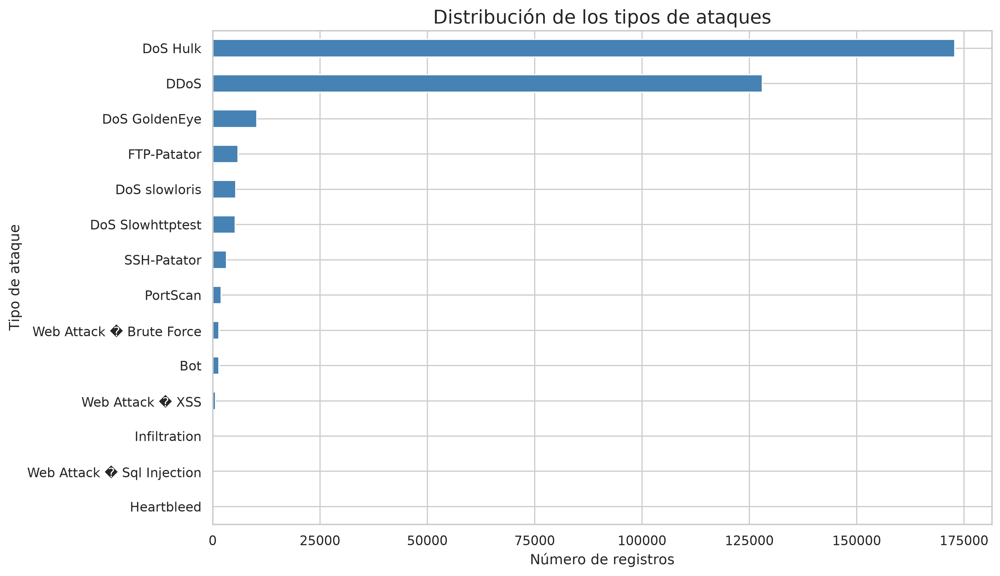
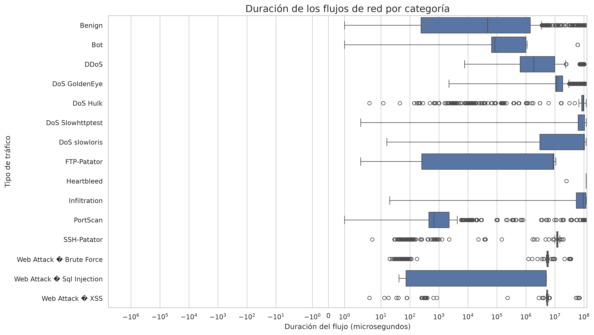

---
title: "Análisis de tráfico de red CICIDS2017"
subtitle: "Exploración y análisis de datos aplicado a la ciberseguridad"
author: "Proyecto académico"
date: today
lang: es
---

# 1. Introducción

La administración de sistemas y la ciberseguridad requieren herramientas que permitan analizar el tráfico de red e identificar comportamientos potencialmente maliciosos.

En este proyecto se realiza un análisis exploratorio y estadístico del conjunto de datos CICIDS2017 mediante Python y la biblioteca Pandas.

El objetivo principal es estudiar las características del tráfico de red, comparar las comunicaciones benignas con las maliciosas e identificar patrones relacionados con diferentes tipos de ataques.

# 2. Fuente de datos

Para el desarrollo del proyecto se ha utilizado el conjunto de datos **CICIDS2017**, obtenido desde Kaggle.

[Consultar el conjunto de datos CICIDS2017 en Kaggle](https://www.kaggle.com/datasets/dhoogla/cicids2017)

Este conjunto contiene registros de flujos de red clasificados según el tipo de tráfico. Incluye comunicaciones benignas y diferentes categorías de ataques, como DoS, DDoS, fuerza bruta, escaneos de puertos y ataques web.

Se ha utilizado una versión del conjunto de datos en formato Parquet, distribuida en ocho archivos.

## 2.1. Características del conjunto

Después de unir los ocho archivos, se obtuvo el siguiente conjunto:

| Característica | Resultado |
|---|---:|
| Número de registros | 2.313.810 |
| Número de columnas | 79 |
| Variables numéricas | 77 |
| Variables de texto | 2 |
| Valores nulos | 0 |
| Archivos originales | 8 |

Se añadió la columna `Dataset_Source` para identificar el archivo de procedencia de cada registro.

Es importante señalar que esta versión del conjunto no contiene marcas de tiempo ni direcciones IP de origen y destino. Por tanto, el análisis se centra en las características de los flujos y sus etiquetas, no en la evolución temporal ni en la identificación de equipos concretos.

# 3. Preparación y limpieza de los datos

Los ocho archivos Parquet se combinaron utilizando Pandas. El resultado se guardó en:

`data/processed/cicids2017_completo.parquet`

Durante la preparación se realizaron las siguientes operaciones:

- Unión de los ocho archivos originales.
- Incorporación de la columna `Dataset_Source`.
- Comprobación de las dimensiones del conjunto.
- Revisión de los tipos de datos.
- Comprobación de valores nulos.
- Identificación de registros duplicados.
- Revisión de valores negativos en la duración de los flujos.

## 3.1. Tipos de datos

Se identificaron 77 columnas numéricas y dos columnas de texto. Esta distribución permite realizar operaciones estadísticas sobre las características de los flujos de red.

## 3.2. Valores nulos

La comprobación realizada no detectó valores nulos en el conjunto de datos.

Esto significa que no fue necesario aplicar técnicas de imputación para completar valores ausentes.

## 3.3. Registros duplicados

Al comprobar los registros sin tener en cuenta la columna `Dataset_Source`, se identificaron 82.004 filas con valores idénticos en sus características.

Estos registros se conservaron para el análisis. Que dos filas tengan los mismos valores no demuestra necesariamente que representen el mismo flujo real, por lo que eliminarlas automáticamente podría provocar una pérdida de información.

## 3.4. Duraciones negativas

Se detectaron 88 registros con valores negativos en la variable `Flow Duration`. Todos pertenecían a la categoría `Benign`.

Como una duración negativa no es válida para estudiar la duración de un flujo, se excluyeron estos registros de los análisis que utilizan esta variable.

No se eliminaron del conjunto original.

# 4. Análisis exploratorio

El análisis exploratorio permite conocer la distribución de las categorías de tráfico y las características generales de los registros.

## 4.1. Distribución de las etiquetas

La variable `Label` identifica el tipo de tráfico registrado.

Las categorías con mayor número de registros son:

| Categoría | Registros |
|---|---:|
| Benign | 1.977.318 |
| DoS Hulk | 172.846 |
| DDoS | 128.014 |
| DoS GoldenEye | 10.286 |
| FTP-Patator | 5.931 |
| DoS slowloris | 5.385 |
| DoS Slowhttptest | 5.228 |
| SSH-Patator | 3.219 |
| PortScan | 1.956 |

La categoría `Benign` representa aproximadamente el 85,46 % del conjunto. Esto muestra que existe un desequilibrio importante entre el tráfico benigno y las distintas categorías de ataques.

## 4.2. Visualización de los ataques

El siguiente gráfico representa la distribución de las categorías maliciosas, excluyendo el tráfico benigno.

Se observa que DoS Hulk y DDoS son las categorías de ataque con mayor presencia en el conjunto de datos.

## 4.3. Análisis del protocolo

La variable `Protocol` permite distinguir los protocolos de red mediante sus identificadores numéricos.

Los valores más frecuentes encontrados son:

| Protocolo | Registros |
|---|---:|
| 6 (TCP) | 1.363.379 |
| 17 (UDP) | 948.842 |
| 0 | 1.589 |

TCP y UDP concentran prácticamente todos los registros del conjunto analizado.

# 5. Análisis estadístico

Se utilizaron medidas estadísticas para estudiar las características de los flujos de red.

Entre las operaciones realizadas se encuentran:

- Media.
- Mediana.
- Recuento de registros.
- Agrupaciones por categoría.
- Comparación de paquetes enviados y recibidos.

## 5.1. Duración de los flujos

La variable `Flow Duration` representa la duración del flujo en microsegundos.

| Medida | Resultado |
|---|---:|
| Media | 18.075.750 µs |
| Mediana | 64.783 µs |
| Mínimo original | -13 µs |
| Máximo | 120.000.000 µs |

La diferencia entre la media y la mediana indica que existen valores de duración muy elevados que influyen en la media.

Por este motivo, la mediana resulta especialmente útil para describir el comportamiento habitual de los flujos.

## 5.2. Comparación entre tráfico benigno y malicioso

Para esta comparación se excluyeron los 88 registros con duración negativa.

| Tipo de tráfico | Registros | Media de paquetes enviados | Media de paquetes recibidos | Mediana de duración (µs) |
|---|---:|---:|---:|---:|
| Benigno | 1.977.230 | 11,96 | 13,85 | 48.648 |
| Malicioso | 336.492 | 5,93 | 4,96 | 63.136.302,5 |

Los resultados muestran diferencias importantes entre ambos grupos.

En este conjunto, los flujos maliciosos presentan una mediana de duración considerablemente superior a la del tráfico benigno.

Sin embargo, esta diferencia no significa que la duración sea suficiente por sí sola para identificar un ataque. Es necesario analizar conjuntamente diferentes características del tráfico.

## 5.3. Duración según la categoría

Se realizó una agrupación por `Label` para calcular el número de registros, la duración media y mediana, y el promedio de paquetes enviados y recibidos.

Algunos resultados destacados son:

| Categoría | Mediana de duración (µs) |
|---|---:|
| Heartbleed | 119.261.118 |
| DoS slowloris | 99.999.406 |
| Infiltration | 93.188.869 |
| DoS Hulk | 86.401.812 |
| DoS Slowhttptest | 63.120.444 |
| Benign | 48.648 |
| PortScan | 674 |

Las diferencias entre categorías muestran que cada tipo de tráfico puede presentar características distintas.

# 6. Operaciones con Pandas

Durante el análisis se utilizaron diferentes herramientas de Pandas para seleccionar, agrupar y resumir los datos.

## 6.1. Agrupación con groupby

Se utilizó `groupby()` para agrupar los registros por la variable `Label`.

Esto permitió calcular estadísticas independientes para cada categoría de tráfico, como la duración media y mediana y el promedio de paquetes enviados y recibidos.

## 6.2. Tablas dinámicas con pivot_table

Se utilizó `pivot_table()` para comparar la media de paquetes enviados (`Total Fwd Packets`) según la categoría de tráfico y el protocolo.

Esta operación permite estudiar cómo se distribuyen determinadas características del tráfico entre diferentes protocolos.

## 6.3. Selección con loc

Se utilizó `loc` para seleccionar registros mediante condiciones sobre las etiquetas.

Por ejemplo, se filtraron las categorías cuyo nombre contiene las expresiones `DoS` o `DDoS`.

## 6.4. Selección con iloc

Se utilizó `iloc` para seleccionar filas y columnas por su posición.

Esta operación permitió consultar una muestra inicial del conjunto de datos y comprobar su estructura.

## 6.5. Filtrado avanzado

También se aplicaron condiciones combinadas para localizar flujos con una duración superior a 60.000.000 microsegundos y más de 100 paquetes enviados.

Se encontraron 7.942 registros que cumplían ambas condiciones.

La muestra obtenida incluía también tráfico benigno. Esto demuestra que una duración elevada y un número alto de paquetes no permiten clasificar automáticamente un flujo como malicioso.

# 7. Visualización de los resultados

Se generaron tres visualizaciones para facilitar la interpretación de los datos.

## 7.1. Distribución de ataques

El primer gráfico muestra el número de registros de cada categoría maliciosa.

Permite identificar rápidamente qué tipos de ataques tienen mayor representación en el conjunto.

## 7.2. Duración del tráfico por categoría

El segundo gráfico utiliza diagramas de caja (*boxplots*) para comparar la distribución de la duración de los flujos entre las diferentes categorías.

Se ha utilizado una escala simétrica logarítmica para facilitar la visualización de valores muy diferentes.

Para facilitar la representación, se ha utilizado una muestra de hasta 1.000 registros por categoría.

## 7.3. Gráfico interactivo

El tercer gráfico permite explorar la relación entre la duración del flujo y el número de paquetes enviados.

Se puede interactuar con la visualización, seleccionar categorías en la leyenda y consultar información adicional al situar el cursor sobre los puntos.

<iframe src="images/03_trafico_interactivo.html" width="100%" height="650px" title="Visualización interactiva del tráfico de red"></iframe>

Esta visualización es interactiva, pero no temporal, ya que la versión del conjunto de datos utilizada no dispone de marcas de tiempo.

# 8. Conclusiones

El análisis del conjunto CICIDS2017 ha permitido estudiar más de dos millones de registros de tráfico de red y comparar diferentes categorías de comunicaciones benignas y maliciosas.

Las principales conclusiones son:

1. El conjunto presenta un claro desequilibrio entre el tráfico benigno y el malicioso, con un predominio de las comunicaciones benignas.
2. DoS Hulk y DDoS son las categorías de ataque con mayor número de registros.
3. La duración de los flujos presenta diferencias importantes entre categorías.
4. La media y la mediana pueden ofrecer interpretaciones distintas cuando existen valores extremos.
5. El análisis combinado de varias características es más adecuado que utilizar una única variable para identificar posibles comportamientos maliciosos.
6. Pandas facilita la exploración, limpieza, agrupación y análisis estadístico de grandes conjuntos de datos.

Como limitación, la versión utilizada no contiene marcas de tiempo ni direcciones IP. Por ello, no ha sido posible estudiar la evolución temporal del tráfico ni identificar los equipos implicados en las comunicaciones.

En definitiva, el proyecto demuestra cómo las herramientas de análisis de datos pueden ayudar a comprender el comportamiento del tráfico de red y aportar información útil en tareas relacionadas con la administración de sistemas y la ciberseguridad.

# 9. Tecnologías utilizadas

- **Python:** lenguaje de programación utilizado para desarrollar el análisis.
- **Pandas:** manipulación, limpieza y análisis de datos.
- **NumPy:** operaciones numéricas.
- **Matplotlib y Seaborn:** generación de gráficos estáticos.
- **Plotly:** creación de visualizaciones interactivas.
- **Quarto:** elaboración y publicación de la documentación.

# 10. Referencias

- Dataset: [CICIDS2017 - Kaggle](https://www.kaggle.com/datasets/dhoogla/cicids2017)
- Documentación de [Pandas](https://pandas.pydata.org/docs/)
- Documentación de [Matplotlib](https://matplotlib.org/stable/)
- Documentación de [Seaborn](https://seaborn.pydata.org/)
- Documentación de [Plotly](https://plotly.com/python/)
- Documentación de [Quarto](https://quarto.org/docs/)

